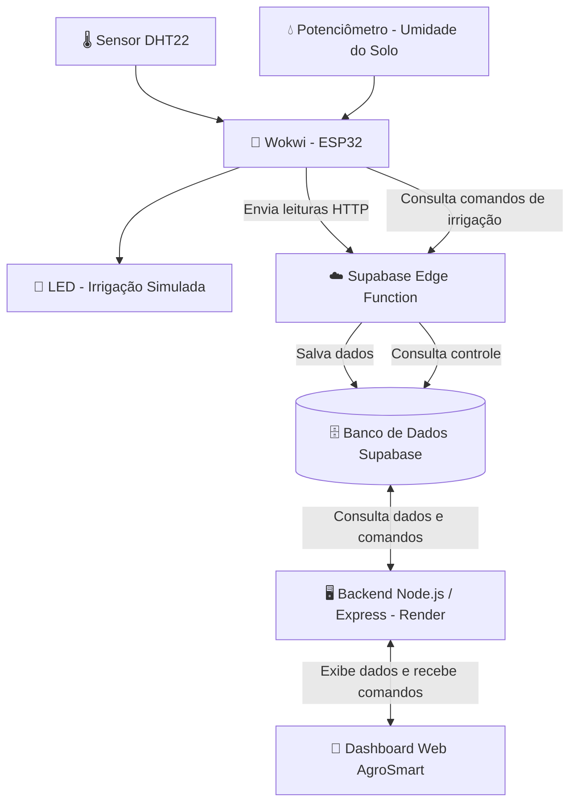

# Arquitetura do Sistema AgroSmart

O AgroSmart é um sistema de monitoramento inteligente de hortas que utiliza sensores simulados, comunicação via internet e uma aplicação web para acompanhar as condições do ambiente e controlar a irrigação.

## Diagrama de arquitetura



## Funcionamento

1. O ESP32 simulado no Wokwi coleta dados de temperatura, umidade do ar e umidade do solo.
2. Os dados são enviados pela internet para uma Edge Function do Supabase.
3. O Supabase armazena as leituras no banco de dados.
4. O backend Node.js, hospedado no Render, consulta os dados e disponibiliza as informações para o dashboard.
5. O usuário acompanha as medições e pode escolher entre irrigação automática, ligada ou desligada.
6. O ESP32 consulta os comandos armazenados e altera o estado do LED, que representa a irrigação.
```

Depois de colar:

1. Pressione **Ctrl + S** para salvar.
2. Pressione **Ctrl + Shift + V** para abrir a visualização Markdown no VS Code.

Se o diagrama aparecer como um fluxograma com caixas e setas, está funcionando!

**Me responda “Diagrama pronto”** ou envie um print da visualização para conferirmos.